# homelab

**Highlights**
- Public-facing services behind a **Cloudflare Tunnel** — zero inbound ports open on my router, real IP never leaves the LAN.
- **Authentik IdP** centralizes auth for ~10 self-hosted apps; one place for MFA, session revocation, OIDC + forward-auth for the ones that don't speak OIDC.
- Survived an **L7 attack on the public Minecraft server** — kept it online with a protocol-aware proxy (Velocity), backend firewall-locked to the proxy's IPs, and handshake-rate limits that actually work (Mojang's built-in whitelist kicks *after* the handshake, too late).
- **OpenAI-compatible local LLM endpoint** so any tool that expects ChatGPT/Claude can point at `localhost` with zero glue code.
- One-shot health check script (`scripts/lab-health.py`, stdlib only) that speaks the Minecraft protocol handshake, not just TCP.

Notes from running a public-facing homelab out of my apartment. Not a runbook — I keep the actual configs and IPs private. This is the stuff I figured out the hard way and would want to remember if I were setting up from scratch.

## What this is

A handful of self-hosted services (media, monitoring, a few internal web apps, a local LLM stack, a public Minecraft server) running on commodity hardware at my place. Domain is `awpdemon.com`. Public entry points sit behind Cloudflare. Anything sensitive sits behind SSO.

## Topology

```mermaid
flowchart LR
    subgraph Internet["Public internet"]
        USER[Browser / client]
        MC[Minecraft client]
    end

    subgraph CF["Cloudflare edge"]
        PROXY[HTTP proxy + WAF + DDoS]
        SPECTRUM[TCP proxy]
        DNS[DNS: awpdemon.com]
    end

    subgraph Lab["Apartment LAN (private)"]
        direction TB
        TUNNEL[cloudflared tunnel]
        AUTH[Authentik IdP + outposts]

        subgraph Apps["Protected apps"]
            MEDIA[Media stack]
            MONITOR[Grafana / Prometheus]
            INTERNAL[Internal web apps]
            LLM[Local LLM<br/>OpenAI-compatible]
        end

        MCPROXY[Minecraft-aware proxy]
        MCBACKEND[Minecraft backend<br/>firewall-locked to proxy]
    end

    USER -->|HTTPS| PROXY
    PROXY -->|outbound-only tunnel| TUNNEL
    TUNNEL --> AUTH
    AUTH -->|OIDC / forward-auth| Apps

    MC -->|TCP 25565| SPECTRUM
    SPECTRUM --> MCPROXY
    MCPROXY --> MCBACKEND

    USER -.-> DNS
    DNS -.-> PROXY
    DNS -.-> SPECTRUM

    classDef edge fill:#f2c811,stroke:#b08400,color:#333
    classDef private fill:#d6eaf8,stroke:#2874a6,color:#1b4f72
    classDef mc fill:#ffe5e5,stroke:#c0392b,color:#7b241c
    class CF edge
    class Lab,Apps private
    class MCPROXY,MCBACKEND mc
```

No inbound ports from the public internet. Everything comes in either through the Cloudflare HTTP proxy (for `*.awpdemon.com`) or the TCP proxy (for Minecraft) and reaches the LAN through the outbound-only `cloudflared` tunnel.

## The problems I had to solve

### 1. Getting services reachable from the internet without exposing my home IP

My ISP hands out dynamic IPs, CGNAT is a thing, and port-forwarding the router is both a security smell and a ticket to every opportunistic scanner on the internet. The answer is a Cloudflare Tunnel — `cloudflared` runs on the lab, makes an outbound connection to Cloudflare, and Cloudflare proxies incoming traffic back through the tunnel.

What this actually buys:
- No inbound ports open on my router, ever. Nothing to find with `nmap`.
- My real IP never touches client connections — Cloudflare sees it, clients see a Cloudflare IP.
- DDoS scrubbing happens at Cloudflare's edge before anything hits my box.
- Cert management is handled by Cloudflare (origin cert + proxy). No Let's Encrypt renewal cron to babysit.

Trade-off: HTTP/HTTPS only on the free tier. For non-HTTP protocols (Minecraft, SSH), you either pay for Spectrum or use a protocol-specific proxy (see below).

### 2. Authenticating self-hosted apps without building a login for each one

Most self-hosted software ships with either no auth or a cursed built-in login page. Running ten of these with ten separate passwords is how you end up with one reused password everywhere.

Solved with **Authentik** as a central IdP. Every protected service sits behind an Authentik outpost — the outpost is a reverse proxy that enforces auth before the request ever reaches the app. OIDC for anything that speaks it, forward-auth for anything that doesn't. One login, one place to revoke a session, one place to enforce 2FA.

Setup gotcha: the outpost needs to be on the same domain (or a subdomain with proper cookie scoping) as the service it guards, otherwise the cookie won't propagate. Took me a few hours of 403s to figure that out.

### 3. Keeping a public Minecraft server online during L7 attacks

Minecraft is TCP 25565. The protocol is chatty, the clients are everywhere, and anyone with a grudge and a booter can make a small server unreachable. Mine got hit.

What worked:
- Put a protocol-aware proxy in front of the server instead of exposing the backend directly. A reverse proxy that understands the Minecraft handshake can drop malformed packets, rate-limit by IP, and absorb connection floods before the backend even sees them.
- Whitelist the backend's firewall to only accept connections from the proxy's IPs. If someone figures out the backend IP directly, they hit a closed port.
- Kick the bot-joiner pattern: too many new unauthenticated handshakes from the same /24 in a short window → temp block. Real players don't do that.
- On the server itself, tune `max-tick-time`, `network-compression-threshold`, and view distance so a single bad tick doesn't snowball. Modded servers with unoptimized plugins are where this bites hardest.

What didn't work: relying on Minecraft's built-in `whitelist` — it kicks you *after* the handshake completes, so you've already spent CPU on the attacker.

### 4. Running inference locally instead of paying per-token

For small automation (summarize a doc, draft a shell command, throw ideas at something), the round-trip to a paid API is both slow and expensive if I'm iterating. Local models on a GPU I already owned are fine for these.

Stack is intentionally boring: a small serving layer (chose something that exposes an OpenAI-compatible API so tools that expect ChatGPT or Claude can point at `localhost` without rewriting), a couple of model weights sized for my VRAM, and a tmux session that stays up. Nothing clever, but the OpenAI-compatible endpoint is the unlock — it means a dozen CLI tools "just work" without any custom glue.

Trade-off I hadn't appreciated: context window costs VRAM *nonlinearly*. Doubling context can quarter your usable batch size. For short-turn tasks this is fine; for long-doc work you're going back to a paid model anyway.

## Sanitized configs

A few reference configs in `configs/` that show the shape without exposing credentials or internal IPs. They're commit-safe — all secrets, tunnel UUIDs, and IPs are placeholders. The actual values live in a `.env` file that never leaves the host.

- [`configs/cloudflared-sanitized.yml`](configs/cloudflared-sanitized.yml) — tunnel ingress rules with timeouts and the `/metrics` endpoint exposed to Prometheus
- [`configs/authentik-proxy-outpost.yml`](configs/authentik-proxy-outpost.yml) — docker-compose for the forward-auth outpost + Caddyfile snippet showing the forward-auth dance
- [`configs/mc-proxy-velocity.toml`](configs/mc-proxy-velocity.toml) — Velocity config with the rate-limits, compression thresholds, and PROXY-protocol passthrough I tuned after the L7 event
- [`configs/prometheus-scrape.yml`](configs/prometheus-scrape.yml) — scrape targets for node exporters, Authentik, cloudflared, `mc-exporter`, and the NVIDIA GPU exporter

## Health check script

`scripts/lab-health.py` is a one-shot health poller — what I run from cron to get an alert if anything important is down. Checks:

- HTTP reachability through the Cloudflare tunnel
- Authentik's login flow endpoint returns 200
- `cloudflared` `/metrics` reports >0 connected tunnel connections
- Minecraft port replies to a proper protocol handshake (not just TCP SYN-ACK — a half-alive server will accept TCP but never respond)
- Local LLM's OpenAI-compatible `/v1/models` has at least one model loaded

Exits nonzero if any check is CRIT, so cron's mail-on-failure does the alerting. `--json` emits machine-readable output for Prometheus `textfile` collection. Written in stdlib only — no pip install, runs on any Python 3.8+ host.

## What I took away

Most of the "homelab is hard" stuff is actually operations-in-miniature — the same problems a startup SRE deals with, just without the pager. DNS, TLS, SSO, reverse proxies, rate limits, capacity planning, observability. I didn't set out to learn any of this, I set out to host a media server and it got out of hand.
